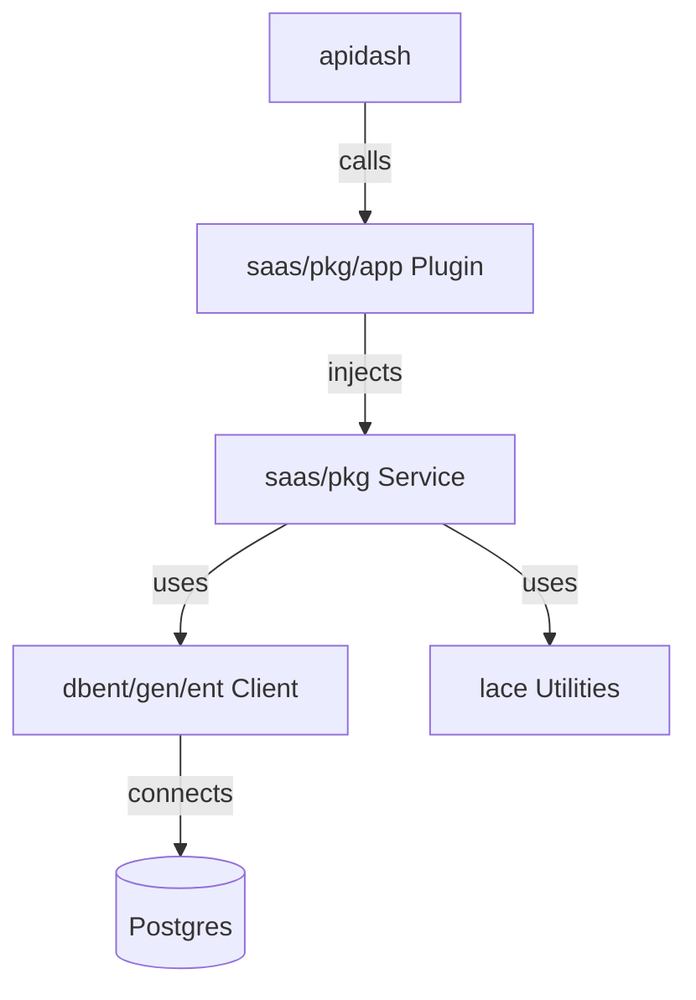

# Architecture

## Workspace & Modules

* Go 1.25 workspace (`go.work`) with independent modules: `saas/` (core app, Ent schemas, CLI/API entrypoints), `apidash/` (dashboard GraphQL), `config/` (config loading/PKL bindings), `lace/` (shared libs: logging, tracing, HTTP/GQL helpers).
* Modules are replace-linked locally in `go.work` to keep fast iterability and allow selective version bumps.

## High-Level Layers (inside `saas/`)

* **Config layer**: PKL configs compiled to Go structs via `config`; injected into services.
* **Infra layer**: DB connection pool (pgx), messaging (NATS), logging/tracing (Loki/Sentry via `lace/nlog`), HTTP server (Gin), GraphQL server (gqlgen), background schedulers.
* **Domain layer**: Ent schemas under `dbent/schema`, domain services in `saas/pkg/...` encapsulating business rules; no direct framework coupling.
* **Application layer**: Use cases orchestrating domain services, publishing/consuming events, handling DTO validation.
* **Delivery layer**:
  * HTTP/GQL: resolvers in `apidash` backed by use cases.
  * CLI: commands under `saas/cmd/cli`.
  * API binary: `saas/cmd/api` boots HTTP/GQL + NATS consumers (Monolith mode).

## Dependency Flow

## State Management

* Stateless HTTP/GQL handlers; state lives in DB/queues/cache.
* Short-lived request context carries correlation IDs + auth claims.
* Idempotency and deduplication implemented at use-case boundaries (e.g., via unique keys, distributed locks).

## Codegen & Build Flow

* `Taskfile.yml` orchestrates generators: Ent (`dbent/cmd/entg`), GraphQL (`apidash/gqlgen.yml`), PKL bindings (`config`), dependency injection (`wire`).
* Builds output to `tmp/` binaries for API/CLI; `go work vendor` keeps vendor parity on servers.
